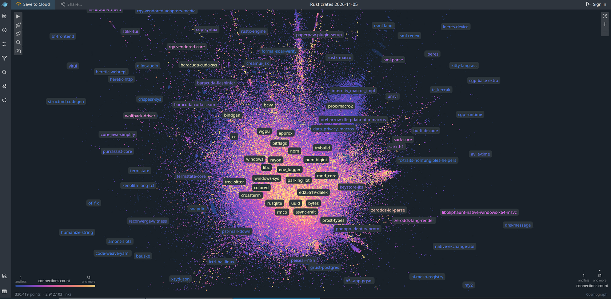

# rust-crates-graph-analysis
Using graph tools on rust crates ecosystem

Following image was generated by downloading information about all rust crates
and shows all crates linked by dependencies. Brighter colors in center show crates most other crates depend on.

to replicate:

1. Go to https://crates.io/data-access, download database dump
2. Uncompress it somewhere, for example to /tmp/db
3. Make sure you have uv installed to run this project
4. Run processing scripts to generate nodes and edges files: `uv run run.py /tmp/db` 
5. Go to https://run.cosmograph.app, load generated nodes.py and edges.py. For edges, set source and target as source and target columns
6. Tweak the graph to your liking

